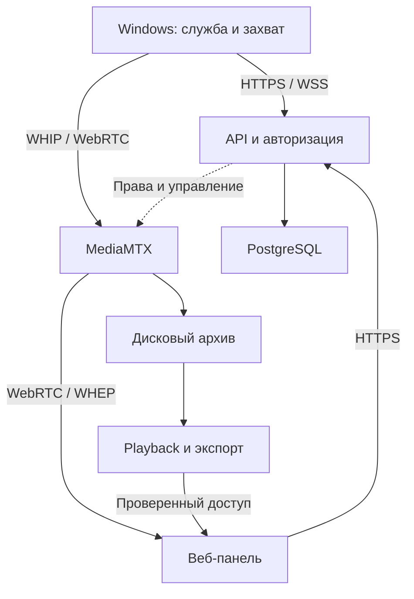

# Экравио / EKRAVIO — техническое задание для Codex

Версия 1.3 · 16 ноября 2026 года · название проекта: Экравио / Ekravio.

Изменение 1.3: проект получил название «Экравио» / Ekravio; добавлены логотип, отдельный знак и правила оформления. Функциональные требования версии 1.2 сохранены.

## Оформление и передача в разработку

Название продукта — **Экравио** (Ekravio), графическое написание — **EKRAVIO**. Слоган: «Экраны, архив и активность — в одном месте». Логотип объединяет рамку экрана и линию активности. Материалы включены в `brand/` в архиве проекта: `ekravio-logo.png`, `ekravio-symbol.png`, `BRAND.md` и `brand-tokens.css`. Изображения имеют прозрачный фон; это растровые оригиналы PNG.

Применить оформление в веб-панели, установщиках, окне сведений об агенте и документации. Сохранить отдельные понятные индикаторы записи, активности и паузы: сам логотип их не заменяет. Для приложения, favicon и tray подготовить и проверить производные системные размеры. Названия компонентов и каталогов далее приведены к Ekravio/ekravio. Если уже есть установленная версия под прежним именем ScreenWatch, сохранить её данные и идентичность устройств при миграции; не создавать параллельную пустую БД вместо переноса.

Изменение 1.2: добавлены обязательный дневной график активности каждого ПК, учёт мыши/клавиатуры при локальной и удалённой работе, отдельный монитор активности пользовательских сеансов, правила расчёта времени, доставка агрегатов, API и проверки RDP/AnyDesk/других средств удалённого управления.

Изменение 1.1: серверная часть обязательна для Windows 10/11, начиная с Home, Windows Server и Linux. Нативная установка Windows без Docker/WSL включена в MVP; обновлены развёртывание, стек, план работ и приёмка.

## 1. Задача и результат

Разработать самостоятельно размещаемую систему просмотра и записи экранов компьютеров. Администратор устанавливает агент на разрешённые ПК, подключает их к своему серверу, открывает веб-панель и видит экраны подключённых компьютеров. Сервер сохраняет видеозаписи независимо от присутствия наблюдателей. Записи доступны по компьютеру, монитору, дате и времени.

Система поставляется как два устанавливаемых продукта:

1. **Windows-агент:** установщик, фоновая служба, процесс захвата экрана и значок состояния в пользовательском сеансе.
2. **Серверный комплект:** API, веб-интерфейс, медиасервер, база данных, файловый архив и фоновые обработчики; установка на обычный ПК с Windows 10/11, начиная с Home, на Windows Server или на Linux.

«Сервер» — роль приложения, а не требование серверной редакции ОС или отдельного физического оборудования. На Windows комплект устанавливается нативно обычным установщиком и работает как службы; Windows Pro, IIS, Docker Desktop, WSL, Hyper-V и виртуальная машина не требуются. На Linux поддержать нативную установку с systemd и дополнительный вариант Docker Compose. Веб-интерфейс, запись, архив, экспорт и права доступа имеют одинаковые возможности на всех целевых серверных ОС. Сервер и агент могут работать на одном ПК, но устанавливаются и настраиваются независимо.

Веб-сайт входит в серверный комплект, отдельный облачный сервис не требуется. Основной сценарий — локальная сеть или корпоративная VPN. Доступ через интернет допускается после настройки TLS, аутентификации и сетевой связности медиапотоков.

**«Архив действий» в этом ТЗ включает видеозапись экрана, технические события и дневную историю активности ввода каждого ПК.** Активность определяется фактами движения мыши и нажатий клавиш, в том числе при удалённом управлении. Содержимое клавиш, введённый текст, пароли, история браузера и файлы не собираются модулем активности. График характеризует наличие ввода и периоды без ввода, а не качество работы или продуктивность человека.

## 2. Требования к платформам и принятые допущения

Серверные платформы заданы заказчиком и обязательны уже в первой версии. Число ПК, срок хранения и параметры агента ниже остаются исходными проектными допущениями. Не заменять обязательную поддержку Windows Home установкой Linux в виртуальной машине. Настройки вынести в конфигурацию там, где это возможно.

| Параметр | Первая версия |
|---|---|
| Агент | Windows 11 x64; отдельная матрица тестов для нужных сборок Windows |
| Сервер: обычный Windows-ПК | Windows 10 22H2 x64 и Windows 11 x64, начиная с Home; Pro и Enterprise также включены. Для Windows 11 зафиксировать проверенные сборки в матрице релиза |
| Сервер: Windows Server | Исходная матрица 2019, 2022 и 2025 x64; нативные службы, без требования роли IIS или Desktop Experience |
| Сервер: Linux | Исходная матрица Ubuntu Server 24.04 LTS и Debian 12/13 x64; нативный systemd-пакет и дополнительный Docker Compose |
| Масштаб пилота | 20 ПК, один записываемый монитор на ПК |
| Несколько мониторов | До двух на ПК в MVP, отдельные потоки и архивы; нагрузка считается по потокам |
| Пользовательские сеансы | Видеозахват MVP — один активный локальный сеанс; монитор активности отдельно обслуживает разрешённые локальные и RDP-сеансы на поддерживаемой агентской ОС |
| Активность ПК | Дневная шкала, мышь и клавиатура, включая удалённый ввод; независима от доступности видеозахвата |
| Порог отсутствия ввода | 60 секунд по умолчанию, настраивается; отображается рядом с графиком |
| Хранение активности | 30 суток по умолчанию, независимо от срока хранения видео |
| Одновременные наблюдатели | До трёх веб-пользователей на пилоте |
| Сетка | 4, 9 или 16 живых экранов на странице; остальные — следующие страницы |
| Запись | Все подключённые и разрешённые политикой мониторы, даже вне текущей страницы сетки |
| Качество по умолчанию | До 1920×1080, 10 кадров/с, H.264, целевой битрейт 1,5 Мбит/с на монитор |
| Хранение | 7 суток, с ограничением общей квоты |
| Расписание | По умолчанию постоянно, пока доступен разрешённый пользовательский сеанс |
| Интерфейс | Русский, тёмная тема, удобная работа на настольном браузере |
| Время | Хранение в UTC; отображение в выбранной IANA-зоне, по умолчанию Europe/Moscow |
| Организации | Одна организация на установку; группы устройств и права внутри неё |

Для агентской части Windows 10, macOS, Linux, захват Windows Server/RDS, одновременная запись нескольких пользовательских сеансов, мобильные приложения и SaaS-мультитенантность — дальнейшие этапы. Это ограничение захвата экранов не относится к серверной части: сервер на Windows 10 Home и Windows Server обязателен в MVP. Не заявлять проверку платформ до фактических испытаний.

Версии Windows Server и Linux в таблице — исходная матрица проверки, а не обещание поддержки любых исторических выпусков. Архитектура первого релиза — x64. Совместимость программы с Windows 10 Home и официальный срок поддержки самой ОС/рантайма — разные характеристики: фиксировать обе, не выдавать запуск за поддержку поставщиком. Если выбранная версия .NET или другой зависимости не подходит, подобрать и проверить совместимый стек; нельзя молча исключить Windows 10 Home из задания или требовать перехода на Pro.

## 3. Границы MVP

### Обязательно

- Установка и удаление агента штатным установщиком.
- Регистрация устройства одноразовым кодом и подтверждение администратором.
- Автозапуск после перезагрузки; захват после появления допустимого пользовательского сеанса.
- Передача экрана агентом на сервер, а не прямое соединение браузера с ПК.
- Живая сетка устройств; открытие одного экрана крупно; выбор монитора.
- Серверная запись, календарь архива, шкала времени, воспроизведение, перемотка и экспорт MP4.
- График активности каждого ПК за день, итоги активного времени и времени без ввода, учёт RDP и ввода других программ удалённого управления без записи содержимого клавиш.
- Пользователи, группы, разграничение доступа к устройствам и отдельное разрешение экспорта.
- Аудит просмотра, экспорта, изменения настроек и административных действий.
- Политики качества, расписания, хранения; контроль дискового пространства.
- Реальные статусы ошибок и разрывов записи; восстановление соединений.
- Отдельные установщики Windows-агента и Windows-сервера, нативная установка Linux с systemd, дополнительный Docker Compose, миграции БД и инструкции каждого способа развёртывания.

### Не входит в MVP

- Управление чужой клавиатурой и мышью, терминал, файловый менеджер, передача файлов.
- Микрофон, системный звук, веб-камера, кейлоггер, перехват буфера обмена.
- Скрытая установка, скрытие процесса или значка, обход защищённого рабочего стола.
- OCR, распознавание действий ИИ, рейтинги сотрудников, аналитика приложений.
- Высокая доступность кластера и непрерывный архив при потере связи с сервером.

Локальный буфер видео для восстановления пропусков и обновление агента через сервер относятся к развитию после MVP; не подменять ими обязательную серверную запись. Ограниченный буфер агрегатов активности, описанный в разделе 5.7, обязателен уже в MVP.

## 4. Архитектура



### Рекомендуемый стек

| Компонент | Решение |
|---|---|
| Агент | C# / .NET LTS, Windows Service + пользовательский процесс; Win32/DXGI через поддерживаемые interop-компоненты |
| Захват | DXGI Desktop Duplication; альтернативный Windows Graphics Capture только после прототипа |
| Кодирование/передача | Нативный медиамодуль на базе GStreamer; H.264 encoder + проверенный WHIP publisher |
| Сервер API | Кроссплатформенное ядро; исходный кандидат ASP.NET Core, REST, WebSocket, OpenAPI. Версию runtime утвердить после проверки всей серверной матрицы, включая Windows 10 Home |
| База | PostgreSQL, EF Core migrations |
| Медиа | MediaMTX: приём потока, выдача WebRTC, запись, playback |
| Фоновые задания | .NET Worker при подтверждении runtime; Windows Service / systemd / контейнер из одной кодовой базы; очередь в PostgreSQL с lease и повторными попытками |
| Фронтенд | React + TypeScript + Vite; библиотека компонентов с таблицами и календарём |
| Прокси | Caddy как общий кандидат для нативных Windows/Linux; HTTPS и маршрутизация. Nginx допустим в дополнительном Linux-профиле |
| Экспорт/проверка медиа | FFmpeg/ffprobe в ограниченном дочернем процессе worker: Windows Job Objects, Linux systemd/cgroups; контейнер только в Docker-профиле |
| Архив | Подключённый дисковый том сервера; интерфейс хранилища для будущего S3 |
| Тесты | xUnit, Playwright, интеграционные тесты нативных Windows/Linux и Compose; отдельные Windows-тесты захвата |

Это выбранное направление реализации, а не утверждение, что любые версии библиотек совместимы. На этапе 0 Codex обязан собрать работающий путь «захват Windows → H.264 → WHIP → MediaMTX → браузер и файл», сначала с нативным сервером на Windows 10 Home, затем с Windows 11 Home, Windows Server и Linux. Проверить состав GStreamer для Windows, наличие нужных плагинов, аппаратный и программный encoder, распространение зависимостей и лицензии. Отдельно проверить серверные runtime, PostgreSQL, MediaMTX, proxy, FFmpeg и service wrapper на целевых ОС. По результату зафиксировать версии и команды сборки в ADR. Не строить весь интерфейс вокруг непроверенного медиастека.

Сервер не использует DXGI, пользовательский рабочий стол или GPU для обычной записи: эти зависимости принадлежат агенту. Серверный GPU необязателен. Общее ядро не должно требовать Win32 или Linux shell; платформенные различия ограничены установкой, запуском служб, путями, правами, секретами и ограничением ресурсов. Нативный MediaMTX и другие вспомогательные процессы запускаются через поддерживаемый service wrapper либо минимальный проверенный supervisor. Не предполагать, что любой EXE сам реализует протокол Windows Service.

Если выбранный WHIP publisher не подходит, оформить ADR с причиной и рабочей альтернативой, сохранив шифрованную передачу, исходящее подключение агента и те же контракты. Не писать собственную реализацию WebRTC с нуля. Сервер по умолчанию маршрутизирует и записывает уже сжатый поток, без обязательного перекодирования всех экранов.

## 5. Агент Windows

### 5.1. Разделение процессов

**Ekravio.Service** отвечает за идентификатор устройства, защищённые учётные данные, связь с API, применение политик, heartbeat и контроль пользовательского процесса.

**Ekravio.Capture** работает с правами текущего пользователя внутри его интерактивного сеанса: захватывает экран, рисует курсор, кодирует видео и передаёт поток.

**Ekravio.SessionMonitor** — отдельный пользовательский процесс с постоянным значком состояния и уведомлениями, а также модулем активности ввода. Запускается в каждом разрешённом подключённом интерактивном сеансе, включая RDP, независимо от capture-процесса. Отказ DXGI, отсутствие монитора или неподдерживаемый видеозахват RDP не прекращают измерение активности. При выключенной записи индикатор всё равно явно сообщает, что учитывается активность. Запуск и восстановление процессов контролирует служба; отсутствие уведомляющего процесса запрещает и захват, и сбор активности этого сеанса.

Windows-службы работают в Session 0; нельзя проектировать захват пользовательского рабочего стола непосредственно из службы. Использовать документированные механизмы запуска процесса в пользовательском сеансе, без интерактивной службы. IPC — локальные named pipes с ACL на службу и конкретный SID/сеанс; проверять сообщения, лимиты, отправителя и версию протокола. Не предоставлять через IPC выполнение произвольных команд.

Минимизировать права службы. Если отдельной операции нужен LocalSystem, изолировать её в малом компоненте и документировать. Процесс захвата не запускать с повышенными правами.

### 5.2. Установка и подключение

1. Администратор создаёт приглашение: сервер, группа, срок действия, одно использование.
2. Установщик показывает название продукта, назначение записи, адрес сервера, размещает запись в «Установленные приложения».
3. Агент проверяет TLS сервера, генерирует собственный ключ устройства и отправляет запрос регистрации.
4. Сервер атомарно погашает код, создаёт устройство `pending`; до подтверждения экраны не передаются.
5. После подтверждения агент получает отдельную идентичность устройства, политику и права публикации только собственных потоков.
6. В пользовательском сеансе отображается уведомление о записи и постоянный индикатор. Если уведомляющий процесс не запущен, захват не начинается.

Код регистрации действителен 15 минут; секрет хранится на сервере в виде хеша. Код не включать в постоянные журналы, имена файлов и командные строки процессов. Идентичность устройства не вычислять только из hostname или MAC. Клонирование уже зарегистрированного системного образа выявлять как конфликт, требующий повторной регистрации.

Устройство использует собственную пару ключей и короткоживущие access-токены; refresh-секрет защищён DPAPI и ACL, на сервере хранится хеш. Протокол обновления токенов должен подтверждать владение ключом устройства. Отзыв устройства закрывает control- и media-сессии и запрещает повторную публикацию.

### 5.3. Захват и видео

- До двух мониторов, отдельные track/path и архив на каждый; стабильный monitor ID и история подключения.
- Сохранять пропорции; по умолчанию уменьшать до 1080p, не растягивать 720p до 1080p.
- Для читаемости мелкого текста предусмотреть конфигурируемое исходное разрешение, включая 1440p/4K; это отдельный нагрузочный профиль, не обещание пилотной мощности.
- Базовый H.264 8-bit 4:2:0 без B-frames; конкретный профиль согласовать с браузерами в прототипе. Ключевой кадр не реже раза в 2 секунды.
- Аппаратный encoder при наличии; программный fallback с ограничением FPS/разрешения и явным статусом деградации.
- Передавать курсор с правильным положением, DPI и поворотом экрана.
- Отсутствие изменений рабочего стола не считать потерей связи; timeline должен сохранять правильную длительность статичного изображения.
- При смене разрешения/монитора завершать текущий сегмент, создавать новую конфигурацию потока и отражать границу в архиве.
- Защищённый контент, UAC secure desktop и экран входа не обходить. Показывать статус недоступности вместо зависшего «живого» кадра.
- Блокировка, выход пользователя, сон: остановить capture/publish и отметить интервал. После возвращения в допустимый сеанс восстановить поток.
- Переключение пользователей: завершить старую сессию, создать новую; кадры разных пользователей не смешивать.
- В MVP видеозахват отдельного RDP-сеанса пока не обязателен: capture показывает `unsupported_session`. При этом сбор активности в RDP обязателен и продолжается через SessionMonitor. Для AnyDesk и аналогов, управляющих обычным console-сеансом, захват работает в пределах возможностей этого сеанса. Переход console → RDP → console проверять отдельно для видео и для активности; статус capture не переносить на activity.

### 5.4. Состояния и устойчивость

Разделять состояние соединения и состояние записи. `online` не означает, что запись работает.

| Поле | Примеры значений |
|---|---|
| connection_state | pending, online, offline, revoked |
| capture_state | starting, streaming, paused, locked, no_session, unsupported_session, error |
| recording_state | recording, stopped_by_policy, storage_full, media_unavailable, error |

Heartbeat каждые 10 секунд; после 30 секунд без heartbeat — offline. Отдельно передавать время последнего кадра и последнего записанного сегмента. Сервер проверяет фактический поток, а не только самоотчёт агента.

Переподключение: экспоненциальная задержка с jitter до 60 секунд. Очереди ограничены; live-поток сбрасывает устаревшие кадры, не накапливает минутную задержку. После возврата сети запрашивается ключевой кадр и создаётся новый recording session.

В MVP при потере сети видео за пропущенный интервал отсутствует. Событие и причина показываются в архиве; не изображать архив непрерывным. Watchdog восстанавливает падение capture-процесса, но не игнорирует явную паузу.

### 5.5. Прозрачность и локальное управление

Значок показывает «идёт запись», «учёт активности», «доступен просмотр», «пауза», «нет связи» или «ошибка», с отдельными статусами видео и активности. Пользователь может открыть состояние, адрес сервера и сведения о программе. Предусмотреть локальную паузу с явным уведомлением администратора; в данном сеансе пауза прекращает захват, передачу новых кадров, запись, обновление превью и сбор новых данных активности. Возобновление сопровождается изменением индикатора. Сервер не должен тайно отменять локальную паузу. Пауза одного сеанса не маскирует состояние другого разрешённого сеанса; в общем графике отражается полнота наблюдения.

Деинсталляция требует стандартных административных прав ОС. Не реализовывать самовосстановление после авторизованного удаления, отключение защиты ОС или маскировку службы.

### 5.6. Измерение активности локальной и удалённой работы

**Обязательное поведение:** движения мыши, нажатия клавиш, клики и прокрутка, поступившие на агентский ПК, обновляют активность независимо от того, сидит человек за этим ПК или управляет им через RDP, AnyDesk либо другую программу. Просмотр удалённого экрана без ввода, сам факт соединения, запущенный remote-control процесс, сетевой трафик, изменение картинки и работа фоновой программы активностью не являются.

Реализация не должна зависеть от закрытого списка имён EXE: использовать сигналы ввода Windows в целевом сеансе. Программно внедрённые события не отбрасывать только из-за injected-флага — они могут поступать от удалённого управления. Такой ввод может происходить также от автоматизации или mouse jiggler; обещать достоверное доказательство присутствия человека нельзя. Специальное распознавание имитации активности не входит в MVP.

**Наблюдение сеансов:** служба отслеживает WTS logon/logoff, connect/disconnect, lock/unlock и запускает SessionMonitor в соответствующих разрешённых пользовательских сеансах. Использовать пару `boot_id + session_instance_id` и Windows session ID; повторное использование Windows ID не объединяет разные сеансы. Блокировка console при активном RDP не означает блокировку всего ПК: состояние определяется отдельно по сеансам, итог по устройству агрегируется на сервере. Не изменять Windows для включения неподдерживаемого RDP-host и не обходить ограничения редакции ОС; RDP тестировать на агентской ОС, штатно принимающей RDP. Поддержка серверной установки на Home остаётся неизменной.

**Источники сигналов:**

1. `GetLastInputInfo` внутри каждого пользовательского сеанса с опросом примерно раз в секунду — базовый сигнал времени последнего ввода, не глобальный датчик для всех сеансов. Вызов из Session 0 не заменяет монитор пользовательских сеансов.
2. При необходимости для покрытия удалённых способов ввода — минимальные low-level mouse/keyboard callbacks в SessionMonitor. Callback только помечает секунду как содержащую ввод, быстро возвращает управление и не блокирует событие. Не сохранять key code, scan code, текст, сочетания клавиш, координаты или траекторию курсора, clipboard и содержимое окон; не включать payload в логи или дампы диагностики. Не связывать ввод с названием документа/приложения.
3. Поддерживать диагностику качества источника и восстановления после его отказа. Объединять сигналы по секундам, не суммировать дубликаты одного ввода. `Raw Input`/физическое устройство не использовать как единственный критерий: требование включает удалённый программный ввод.

Конкретную комбинацию источников подтвердить прототипом и ADR: нет универсальной гарантии, что любой будущий remote-control продукт использует одинаковый механизм Windows. Архитектура должна поддерживать расширение через документированные адаптеры, если программа обходит базовые сигналы. Для непроверенного продукта не заявлять сертифицированную совместимость; для обнаруженного отказа датчика выводить «нет достоверных данных», а не «простой». Не добавлять интеграцию с каждой программой, если общие сигналы уже работают.

MVP обязательно проверить: физическую мышь/клавиатуру, RDP, AnyDesk, TeamViewer, RustDesk и RuDesktop в доступных штатных режимах. Фиксировать точные версии продукта, ОС, portable/installed/service-режим, уровень прав и результаты движения мыши/клавиатуры. Отсутствующая лицензия или тестовое окружение обозначаются как непроверенный сценарий, а не успешная проверка. Требование учитывать удалённый ввод не откладывать на следующую версию.

**Происхождение ввода:** наличие RDP-сеанса подтверждается WTS; injected-флаг не доказывает, что ввод пришёл через AnyDesk. Хранить отдельно `session_transport = console | rdp | unknown` и подтверждённый remote-control context, если он доступен через проверенную интеграцию. Для console-сеанса с AnyDesk без такой интеграции выводить «ввод; источник не определён», сохраняя активность. Не называть такой ввод локальным и не приписывать его конкретной программе или человеку. Времена remote-connect показываются отдельным слоем и не заменяют активные интервалы.

### 5.7. Правила времени, качества данных и передачи активности

Порог `idle_timeout_seconds` по умолчанию 60, диапазон настройки 15–900 секунд. Это допущение расчёта; значение видно в UI. Разрешение первичного агрегата — одна секунда. Для каждой наблюдаемой секунды хранить лишь `input_seen`, качество наблюдения и состояние сеанса; тип mouse/keyboard допускается, только если источник его надёжно различает, иначе `unspecified`. Частота/содержание отдельных нажатий не нужны.

Определение для одного сеанса: зарегистрированный ввод в момент `t` создаёт активный интервал `[t, t + timeout)`. Пересекающиеся интервалы объединяются. Интервал ограничивается подключённым, разблокированным, разрешённым расписанием и достоверно наблюдаемым временем; при паузе, блокировке, logoff, disconnect, сне или отказе датчика обрывается. Начало подключения, вход или разблокировка сами по себе не создают активность. Исторический stale timestamp нельзя принять за новое событие.

Пример при пороге 60 секунд: ввод в 09:00:00 и 09:00:20 создаёт активность 09:00:00–09:01:20, затем начинается «нет ввода», если наблюдение продолжается. Чтение текста без ввода после порога попадает в «нет ввода»; не подписывать это как «не работал». В UI дать возможность проверить результат на другом пороге, только если сохранённых агрегатов достаточно; в MVP расчёт по записанной версии политики, без скрытого пересчёта всей истории.

Хранить отдельно:

- состояние работы: `active`, `idle`, `locked`, `disconnected`, `no_session`, `paused`, `outside_schedule`, `unknown`;
- полноту данных: `complete`, `partial`, `unavailable`;
- соединение с сервером: online/offline и время последнего принятого пакета.

Итог ПК — объединение активных интервалов всех разрешённых сеансов, а не сумма: два сеанса по 30 минут одновременно дают 30 минут активности ПК. Если активность подтверждена хотя бы в одном сеансе, она учитывается даже при недоступности другого, но полнота отмечается partial. Если активность не подтверждена и хотя бы один ожидаемый сеанс не наблюдается, итог — unknown, а не idle. Idle допустим при полном наблюдении, когда хотя бы один доступный разблокированный сеанс находится без ввода; locked/no_session допустимы только при подтверждённом состоянии всех относящихся к ПК сеансов. Уточняющие строки по сеансам сохраняют их отдельные состояния. Паузы и исключения расписания не являются idle.

Счётчик времени использует монотонные часы и привязку к UTC для каждого boot/session epoch. Учитывать wraparound LASTINPUTINFO, немонотонные timestamps, suspend/resume и перевод часов. Недопустимое значение не превращать в часы активности; снижать качество данных и фиксировать диагностику. Точность нормальных границ — до 2 секунд; при неизвестной привязке времени не обещать точную синхронизацию с видео.

Пакеты агрегатов отправлять каждые 15 секунд через отдельный HTTPS API либо защищённый control-channel. На агенте обязателен зашифрованный ограниченный буфер **только телеметрии активности**: до 24 часов и 50 МБ, срабатывает первый лимит. Буфер видеозаписи по-прежнему относится к дальнейшему развитию. Буфер хранит агрегаты секунд, переходы состояний, policy version, boot/session IDs и последовательность; никаких исходных key/mouse payload. До подтверждения сервера данные могут повторяться; сервер дедуплицирует по device/boot/session/sequence. Отправленные подтверждённые данные удаляются локально.

При потере сети агент продолжает разрешённое наблюдение, а UI показывает offline и ещё не полученные интервалы как unknown. После восстановления доставляет агрегаты, обновляет график и снимает предварительную неопределённость только на покрытых участках. Превышение буфера, падение процесса и потерянные пакеты создают явные gaps; не заполнять их нулевой активностью. Новый live-пакет имеет приоритет перед backlog. При отзыве устройства приём буфера прекращается; незагруженные данные удаляются по локальной политике, не передаются под другой идентичностью.

Расписание учёта активности отдельно от расписания видео, по умолчанию — весь доступный разрешённый сеанс. Выключение записи или ошибка диска видео не выключают activity monitor. Общая локальная пауза останавливает оба вида наблюдения. Изменения порога, расписания и политики хранения версионируются и аудитируются. На сервере агрегаты хранятся 30 суток по умолчанию; данные диаграммы и итогов удаляются согласованно, сохраняя только отдельный технический аудит в пределах его политики.

## 6. Передача и медиасервер

### 6.1. Потоки

- Control-plane: HTTPS/WSS, агент инициирует исходящее соединение.
- Публикация: WHIP/WebRTC от агента в MediaMTX; медиа DTLS-SRTP.
- Просмотр: WHEP/WebRTC от MediaMTX к браузеру. Браузер не подключается к агенту.
- Архив: защищённые HTTP-запросы к playback через приложение/прокси с проверкой прав.
- Один upstream на каждый записываемый монитор; дополнительные наблюдатели не создают дополнительные encoder на агенте.

Имя потока назначает сервер: `devices/{deviceId}/sessions/{sessionId}/monitors/{monitorId}`. Агент не может передать произвольный путь другого устройства. Внешние идентификаторы валидируются; пользовательские названия не использовать как файловые пути.

MVP может передавать одинаковый основной поток для записи и live-сетки. Не обещать экономию сети от визуального уменьшения карточки. На следующем этапе — дополнительный низкокачественный поток для сетки; он не записывается и требует отдельного бюджета encoder/трафика.

### 6.2. Сеть

| Порт/доступ | Назначение |
|---|---|
| TCP 443 снаружи | Веб-интерфейс, API, WHIP/WHEP signaling и playback через TLS-прокси |
| UDP 8189 снаружи | Прямой WebRTC media, конфигурируется |
| TCP 8189 при включении | Дополнительный прямой WebRTC transport; проверить в прототипе |
| TURN по необходимости | UDP/TCP 3478, TLS 5349 и выделенный relay-range; отдельная конфигурация |
| PostgreSQL, MediaMTX control/playback/metrics, workers | Loopback при нативной установке либо внутренняя сеть контейнеров в Docker-профиле; не открывать в LAN/интернет |

Не утверждать, что обычный HTTPS reverse proxy решает передачу WebRTC через любой firewall. Настроить advertised ICE addresses, входящие правила Windows Firewall или Linux firewall и NAT; публикация портов контейнера нужна только Docker-профилю. Для сетей с заблокированным UDP включить испытанный TURN/TLS-вариант. TURN может быть отдельным сетевым сервисом: нативная установка Windows-сервера и работа в LAN не зависят от его наличия или Linux-компонента. Если требуется TURN на 443, выделить отдельный IP или сетевую схему; он не может просто занять уже используемый HTTPS-порт на том же адресе. В ограниченных сетях разрешить fallback просмотра через авторизованный HLS с большей задержкой, но публикация агента всё равно должна иметь рабочий маршрут.

Порты на ПК агента вручную не открываются. При недоступной передаче диагностировать проблему; никаких обходов корпоративных средств защиты.

### 6.3. Авторизация медиа

У MediaMTX закрыть анонимные publish/read/playback, административные API и metrics. Использовать внешний HTTP auth-сервис с проверкой короткоживущего media ticket: `subject`, `deviceId`, точный `path`, `action`, `exp`, `sessionId`, `jti`. Ticket на публикацию не разрешает просмотр; ticket наблюдателя не разрешает публикацию.

API выдаёт ticket только после проверки ACL и актуальности пользовательской/агентской сессии. Передавать bearer в заголовке, а не постоянный токен в URL. Срок ticket — до 5 минут; продление только через API. Проверить, что выбранная версия медиасервера закрывает сессию по expiry; иначе реализовать принудительное отключение по таймеру и отзыву. Смена прав/отзыв пользователя должны закрывать уже открытые потоки не позднее 30 секунд, а не только блокировать новые подключения.

Нативный video-element не добавляет произвольные Authorization-заголовки: для архива использовать одноимённый HTTPS-origin и защищённую cookie-сессию либо fetch/MSE. Любой manifest, segment, Range-запрос и экспорт проверяются на сервере. Не выдавать прямой открытый путь к диску или публичному playback-порту.

## 7. Запись и хранение

### 7.1. Формат и целостность

- Запись выполняется на сервере по политике независимо от открытых веб-страниц.
- fMP4-сегменты ориентировочно по 60 секунд, внутренние части около 1 секунды; параметры проверить на закреплённой версии MediaMTX.
- Разделять устройство, session, монитор, дату UTC и уникальный segment ID. Не перезаписывать файлы при повторных подключениях или переводе часов.
- Индексировать закрытые сегменты: начало/конец, длительность по медиа, размер, кодек, разрешение, путь, контрольная сумма, причина завершения.
- Хуки медиасервера передают событие готовности; фоновая сверка восстанавливает индекс после пропущенных хуков или сбоя API.
- Состояния сегмента: writing, ready, corrupt, deleting, deleted. `ready` только после проверки файла. Метаданные в БД, видеоданные на диске, не в PostgreSQL.
- Удаление идемпотентно: пометка deleting → удаление файла → фиксация результата; после сбоя повторять безопасно.
- После аварии медиасервера проверить незавершённые файлы, сохранить читаемые части, повреждённое пометить. Не обещать нулевую потерю последних кадров.
- Актуальный незакрытый сегмент может появляться в архиве с задержкой до 90 секунд; live-просмотр от этого не зависит.

Часы сервера синхронизировать NTP. Для таймлайна использовать серверное UTC и монотонные PTS с привязкой к началу сессии; время агента хранить отдельно для диагностики. Смещение часов агента более 5 секунд отображать предупреждением. Не строить уникальность и последовательность только на wall clock агента.

### 7.2. Политики

По умолчанию запись включена во время доступной сессии. Можно задать дни недели, интервалы и часовой пояс. Вне расписания по умолчанию отключены и запись, и live-доступ. Отдельный явно выбранный режим «только live без записи» разрешён администратору и виден на агенте.

Приоритет настроек: индивидуальные переопределения устройства → одна назначенная ему policy-group → глобальные настройки. Отдельные группы доступа могут пересекаться, но политики записи не должны конфликтовать неявно. Хранить desired/applied policy version и время применения. Изменение записи/расписания применяется не позже 30 секунд при исправной связи; при потере API агент использует последнюю подтверждённую локально политику.

Хранение — 7 суток по времени окончания сегмента, настраиваемая квота в байтах и резерв свободного места. Cleanup каждые 5 минут. Предупреждения при 80% и 90% квоты; при 95% файловой системы либо свободном месте менее `max(5 ГБ, 5%)` прекратить новые записи и показать критическую ошибку. Продолжение live допустимо при исправном медиасервере. Возобновить запись после освобождения места до порога с гистерезисом.

Штатная очистка удаляет истёкшие по retention записи. Досрочное удаление самых старых записей в пределах retention допускается только отдельной настройкой `evict_oldest`; по умолчанию выключено. При её выключении переполнение означает остановку записи, а не скрытое уменьшение срока хранения. Не удалять открытый сегмент и файлы активного экспорта; pin экспорта ограничен TTL. Поддержать безопасное освобождение зависших pin.

Шифрование диска сервера — настройка развёртывания; приложению нельзя обещать end-to-end encryption, поскольку сервер должен записывать и воспроизводить видео. Логи не содержат кадров и секретов.

## 8. Веб-панель

### 8.1. Вход и права

Локальные учётные записи, проверенная библиотека аутентификации, ограничение попыток входа, безопасное восстановление администратора через серверную CLI. Первый администратор создаётся одноразовой setup-процедурой; постоянных стандартных паролей нет. TOTP обязателен для администраторов, коды восстановления хранятся хешированными. Cookies: HttpOnly, Secure, SameSite; CSRF-защита для изменяющих запросов. OIDC/AD/LDAP — следующий этап.

| Роль | Права |
|---|---|
| Администратор | Устройства, группы, пользователи, политики и сервер; просмотр и архив в назначенной области доступа |
| Оператор | Live и архив разрешённых групп; без управления пользователями |
| Наблюдатель | Только live разрешённых групп |
| Аудитор | Журнал событий; видео только при отдельном разрешении |

Экспорт — отдельное разрешение; аудит — отдельное разрешение. Просмотр графика активности — отдельное `activity.read`, ограниченное назначенными устройствами/группами; изменение его политики — `activity.manage`. По умолчанию activity.read есть у администратора и оператора в их области доступа, нет у наблюдателя/аудитора без явного назначения. Deny by default. Проверять права в API и медиаслое, а не только скрывать кнопки. Системный администратор ОС технически способен читать серверные файлы — это граница доверия, а не защищённость, которую должен имитировать UI.

### 8.2. «Все компьютеры»

- Сетка 2×2, 3×3 и 4×4, постраничная навигация, поиск по имени, фильтры группы и состояния.
- Карточка: имя ПК, группа, выбранный монитор, последнее обновление кадра, соединение и запись отдельно.
- Последний кадр offline-устройства затемнён и помечен временем; кнопка увеличения не изображает live при отсутствии потока.
- Подписываться на видимые карточки. Уход со страницы закрывает WHEP-сессии; сворачивание вкладки приостанавливает live после 30 секунд.
- Ошибка одного потока не ломает сетку. При перегрузке браузера предложить меньшую сетку, не выдавая устаревшие кадры за актуальные.
- Базовая сетка действительно показывает живое видео; замена её редкими скриншотами без явного отдельного режима не считается выполнением требования.

### 8.3. «Компьютер»

Крупный live-плеер, полноэкранный режим, переключатель монитора, состояние, версия агента, последняя связь, разрешение/FPS/битрейт и ошибки. Вкладки: «Онлайн», «Архив», «Активность», «События», «Настройки». На карточке ПК — мини-шкала активности за текущий день и время последнего ввода при наличии activity.read. Управление качеством, политикой, группой и отзыв устройства — по правам. Команды только из фиксированного перечня; произвольного shell endpoint нет.

### 8.4. «Архив»

Выбор устройства, монитора, даты, времени и зоны. Шкала различает записанные интервалы, паузу, блокировку, offline, отсутствие данных и ошибки диска. При недоказанной причине показывать «нет данных», а не придумывать событие.

Воспроизведение 0,5×/1×/2×/4×, переход к времени, масштаб шкалы, переход к следующему доступному интервалу. На разрыве — явное сообщение и кнопка перехода; не подставлять последний кадр на всю длительность пропуска. Разные разрешения и сессии корректно переключаются. Переход между сегментами реализуется приложением, а не бесконечным списком ссылок на файлы.

Экспорт MP4: выбранный диапазон, максимум 60 минут на задание по умолчанию; очередь, прогресс, отмена, лимиты CPU/памяти и два параллельных задания на сервер. Для точной обрезки вне ключевого кадра допустимо перекодирование в worker. Если диапазон включает разрыв, UI требует выбрать непрерывный участок или скачать несколько явно названных клипов. Не склеивать пропуски так, будто время было непрерывным. Временные экспортные файлы удаляются через 24 часа, скачивание повторно проверяет ACL.

### 8.5. Остальные страницы

- Регистрация агентов и ожидающие подтверждения устройства.
- Группы, пользователи и выдача прав.
- Политики, расписание, качество, retention и квота.
- Состояние сервера: диски, объём архива, прогноз заполнения, ingest/egress, ошибки записи и экспорта.
- Аудит с фильтрами по пользователю, устройству, действию и периоду.

На телефоне достаточно списка устройств, одного live-плеера и базового архива; 16 одновременных видео на мобильном не требуется.

### 8.6. «Активность» — дневной график каждого ПК

Выбор даты и часового пояса, кнопки «сегодня», предыдущий/следующий день. Основная горизонтальная шкала охватывает выбранный календарный день; масштабирование до часа/минуты. Не предполагать всегда 24 часа: границы дня вычисляются из IANA-зоны, при переводе часов подписи содержат UTC offset. Для текущего дня будущее остаётся пустым, а не idle.

Цвета и подписи: зелёный — «активность ввода», светло-серый — «нет ввода», тёмно-серый — «заблокировано/нет сеанса», синий — «пауза/вне расписания», штриховка — «нет данных». Не полагаться только на цвет: легенда, текст и tooltip обязательны. Offline показывается отдельным сетевым слоем, поскольку после загрузки локального буфера активность в offline-интервале может оказаться известной.

Верхние показатели: активное время ПК, время без ввода, заблокированное время/нет сеанса, паузы/вне расписания, неизвестное время и полнота наблюдения. Процент активности считать только как `active / (active + idle)` для полного наблюдения; при нулевом знаменателе показывать «нет данных». Для partial-дня явно указывать неполноту и подтверждённый минимум активного времени, не выдавать его за точный полный итог. Сумма непересекающихся состояний должна совпадать с отображаемой прошедшей частью дня с учётом точности агрегатов.

Под основной шкалой — подтверждённые remote-connect интервалы и, при нескольких сеансах, раскрываемые строки сеансов. Для RDP показывать RDP; для сторонней программы название показывается только при подтверждённом источнике, иначе «тип удалённого управления не определён» либо «источник ввода не определён». Даже при неизвестном источнике сам ввод включается в зелёные интервалы.

Tooltip содержит начало/окончание, длительность, статус, установленный порог idle, полноту и источник подтверждения remote-context. Клик по времени открывает архив соответствующего ПК; если в этот момент видео отсутствует, RDP capture не поддержан или монитор неизвестен — объяснить это и предложить выбор доступного монитора, не создавать фиктивную связь между сеансами. Обновление текущего дня — не реже раза в 15 секунд, end-to-end задержка новых данных в штатной сети — не более 30 секунд.

Дополнительная диаграмма по минутам может показывать число секунд с зарегистрированным вводом от 0 до 60; это другой показатель, чем active-время с timeout. Не смешивать их под одним названием. Нужна возможность получить полный график устройства независимо от наличия видеозаписей за этот день.

## 9. API и модель данных

Версия API `/api/v1`. OpenAPI является частью поставки. Все list-endpoint имеют пагинацию; интервалы запросов ограничены. Ошибки — единый problem-details формат с code и requestId. UUID не заменяет проверку доступа.

| Endpoint | Назначение |
|---|---|
| POST /enrollment-tokens | Создание одноразового приглашения |
| POST /agents/enroll | Регистрация устройства, возврат pending |
| POST /devices/{id}/approve | Подтверждение регистрации |
| POST /devices/{id}/revoke | Отзыв устройства и активных сессий |
| POST /agent/auth/refresh | Обновление device session с проверкой ключа |
| WSS /agent/control | Heartbeat, события, политики, подтверждения |
| GET /devices, GET /devices/{id} | Список и состояние |
| PATCH /devices/{id} | Имя, policy-group, переопределения |
| POST /media/publish-ticket | Публикация собственного разрешённого потока |
| POST /media/view-ticket | Авторизованное начало просмотра |
| POST /media/authorize | Внутренний callback медиасервера |
| GET /devices/{id}/recordings | Покрытие указанного временного диапазона |
| POST /agent/activity/batches | Приём агрегатов только своего устройства; sequence, idempotency и ack |
| GET /devices/{id}/activity | Интервалы/агрегаты дня с timezone, completeness, policy version и revision |
| GET /devices/{id}/activity/summary | Итоги дня по той же версии данных и правилам агрегации |
| PATCH /devices/{id}/activity-policy | Порог, расписание и хранение с проверкой activity.manage |
| GET /recordings/{id}/playback | Доступ к конкретному записанному интервалу |
| POST /exports, GET /exports/{id} | Создание и состояние экспорта |
| GET /exports/{id}/download | Авторизованное скачивание |
| GET /audit, GET /system/status | Аудит и диагностика |

Добавить CRUD пользователей/групп/политик, logout, MFA и административные операции. Запись политик с optimistic concurrency; повтор регистрации/экспорта с idempotency key не создаёт дубликаты. Ограничить скорость и размер запросов, число активных stream sessions пользователя. WebSocket проверяет Origin и сессию; сообщения имеют schema version, messageId, correlationId, максимальный размер и ack.

Основные таблицы:

- `users`, `roles`, `user_sessions`, `mfa_credentials`;
- `device_groups`, `group_memberships`, `access_grants`, `recording_policies`;
- `devices`, `device_credentials`, `enrollment_tokens`, `monitors`;
- `capture_sessions`, `device_events`, `policy_deliveries`;
- `activity_sessions`, `activity_policies`, `activity_batches`, `activity_samples`, `activity_intervals`, `activity_daily_summaries`, `activity_gaps`;
- `recording_segments`, `recording_gaps`, `export_jobs`, `export_segment_pins`;
- `audit_events`, `system_alerts`, `background_jobs`.

`recording_segments`: UUID, device/session/monitor IDs, start_utc, end_utc, duration_ms, pts_start, codec, width, height, size_bytes, storage_key, sha256, status. Индекс по `(device_id, monitor_id, start_utc)`. `audit_events`: actor, действие, объект, время сервера, результат, requestId, IP; без секретов и содержимого экрана. У приложения нет операций изменения уже записанного аудита; root-доступ к БД остаётся доверенной границей. Политику хранения аудита задать отдельно, например 180 суток, без хранения в нём самих кадров.

`activity_samples` хранит компактные блоки секундных флагов/coverage, а не миллионы строк отдельных движений или нажатий. Каждый блок содержит device_id, boot_id, session_instance_id, sequence, UTC anchor, monotonic range, input_seen/coverage bitmaps, переходы состояний, policy_version и качество времени. Поля key code/text/cursor coordinates запрещены в контракте. `activity_sessions` отделена от capture_sessions: RDP-активность существует без видео. `activity_intervals` и daily summaries — производные данные; запоздавший batch пересчитывает затронутый интервал, соседнюю границу timeout и соответствующие дни, увеличивая revision. Summary и график читаются из согласованной revision. Не хранить одну глобальную summary на дату без timezone: использовать cache key device/date/timezone/policy/revision либо считать итоги из UTC-интервалов на запросе. Партиционирование и retention выполняются по времени наблюдения, не только по времени доставки.

Endpoint приёма активности ограничивает размер batch, скорость, допустимый возраст, последовательность, диапазон времени и принадлежность сеанса устройству; неизвестные поля ввода отклоняются. На дубликат возвращается тот же ack без удвоения итогов. Данные старше retention не восстанавливаются поздней загрузкой. Просмотры графика и изменения activity policy аудитируются без фиксации исходного ввода.

## 10. Производительность и расчёт ресурсов

Все показатели ниже — цели пилота, которые нужно измерить, а не обещания без испытаний.

| Проверка | Цель |
|---|---|
| Первый кадр после открытия | p95 ≤ 5 секунд в LAN |
| Задержка live | p95 ≤ 2 секунд в LAN при 1080p/10 fps |
| Начало записи после готовности capture и сети | ≤ 15 секунд |
| Восстановление после возврата сети | ≤ 90 секунд с учётом backoff |
| Новая запись в архиве | ≤ 90 секунд после закрытия соответствующего минутного интервала |
| Отзыв прав/устройства | Закрытие активного доступа ≤ 30 секунд |
| Агент с hardware encoder | Средний CPU ≤ 15% суммарного CPU, RAM ≤ 400 МБ на тестовом ПК |
| Непрерывное испытание | 24 часа, без утечек памяти, зависаний и необъяснённых дыр в архиве |

В отчёте указать точную модель CPU/GPU, драйвер, ОС, версии зависимостей, число потоков, среднюю и p95 нагрузку. Программный encoder и два монитора измеряются отдельно; не переносить на них показатели одного аппаратного encoder.

Формула полезного видеообъёма, десятичные ГБ:

`ГБ = число записываемых потоков × средний Мбит/с × 3600 × часов записи в день × дней / 8 / 1000`.

Пример при **среднем**, а не пиковом, битрейте 1,5 Мбит/с:

| Сценарий | Видео за сутки | Видео за 7 суток |
|---|---:|---:|
| 1 монитор × 8 часов | 5,4 ГБ | 37,8 ГБ |
| 20 мониторов × 8 часов | 108 ГБ | 756 ГБ |
| 20 мониторов × 24 часа | 324 ГБ | 2 268 ГБ |

К видео добавить минимум 25% на запас, контейнеры, экспорты и работу очистки; резервные копии считать отдельно. Для последнего примера расчёт с 25% составляет 2 835 ГБ. VBR, динамичное изображение и исходное 4K могут существенно изменить реальный объём.

20 потоков по 1,5 Мбит/с — около 30 Мбит/с входящего полезного видео. Сетка из 16 потоков основного качества — около 24 Мбит/с на браузер; три такие сетки — около 72 Мбит/с исходящего видео плюс накладные расходы. Два монитора на каждом ПК удваивают число записываемых потоков. TURN добавляет собственный сетевой бюджет.

Начальный стенд для измерений: сервер 8 vCPU, 16 ГБ RAM, отдельный быстрый диск архива и сеть 1 Гбит/с. Это исходная конфигурация теста, не гарантированная мощность для любого профиля. Не закладывать серверное перекодирование каждого потока в данный бюджет.

## 11. Безопасность и эксплуатация

- TLS с валидацией сертификатов, поддержка внутреннего CA; никаких `skip verification` в production.
- Секреты через защищённые файлы/secret mounts; примеры конфигурации без реальных ключей.
- Изоляция медиасервера, БД и worker; запрет произвольного URL/path в заданиях FFmpeg.
- Авторизация на каждом объекте; негативные тесты подмены device/monitor/segment ID.
- Видео доступно только назначенным пользователям. Предпросмотры, кеши и загрузки имеют `Cache-Control: private, no-store` там, где требуется; общедоступного CDN нет.
- Аудитирует начало/окончание live-сессии, открытие архивного диапазона, создание/скачивание экспорта, вход/ошибку входа, изменение прав, политики, удаление и регистрацию. Нельзя логировать каждый кадр как отдельное событие.
- Сборки с закреплёнными зависимостями и SBOM; проверить лицензии кодеков/медиабиблиотек перед распространением.
- Production-инсталлятор и обновления подписываются сертификатом владельца. В dev допустима явно обозначенная неподписанная сборка; не фабриковать подпись и не обходить предупреждения ОС.
- Поставить health/readiness endpoint, метрики количества активных потоков, возраста последнего кадра/сегмента, объёма диска, backlog и ошибок.
- Резервное копирование: БД + конфигурация + секреты по защищённой процедуре; видео по отдельной политике. Проверить восстановление БД и индекса на тестовой копии архива.
- До включения на реальных ПК владелец развёртывания определяет круг устройств, пользователей с доступом, сроки хранения и порядок уведомления. Программа обеспечивает уведомления и контроль доступа технически; юридические документы не входят в это ТЗ.

## 12. Развёртывание и структура репозитория

```text
agent/
  Ekravio.Service/
  Ekravio.Capture/
  Ekravio.SessionMonitor/
  Ekravio.Shared/
  installer/
server/
  Ekravio.Api/
  Ekravio.Worker/
  Ekravio.Domain/
  Ekravio.Infrastructure/
web/
contracts/
deploy/
  windows/
    installer/
    services/
  linux/
    packages/
    systemd/
  docker/
    compose.yaml
  mediamtx/
  proxy/
  turn/
tests/
  integration/
  e2e/
  windows/
  load/
docs/
  adr/
  installation.md
  operations.md
  security.md
  testing.md
  known-limitations.md
```

### 12.1. Windows 10/11 Home и Windows Server — нативный комплект

Поставлять `Ekravio-Server-Setup-x64.exe` или MSI с bootstrapper. Установка с правами администратора; после установки работа без входа пользователя и без открытого браузера. Никаких обязательных Docker, WSL, Hyper-V, IIS, домена AD или серверной редакции Windows. Для Server Core предусмотреть unattended-установку и управление через CLI/веб-интерфейс; тестировать этот вариант отдельно.

Мастер устанавливает API/web, worker, MediaMTX, proxy и изолированный экземпляр PostgreSQL либо подключает уже существующую совместимую БД. .NET при его выборе публиковать self-contained; SDK на целевой машине не нужен. Собственный экземпляр БД имеет отдельное имя службы, каталог и порт; не перезаписывать пользовательскую БД. Совместимые зависимости включить в пакет или предусмотреть явную загрузку и отдельный полный offline-пакет; закрепить версии и проверить права распространения.

Службы: `Ekravio.Server`, `Ekravio.Worker`, `Ekravio.Media`, `Ekravio.Proxy`, при комплектной БД `Ekravio.Database`. У каждой автозапуск, recovery policy, контролируемые логи и минимальные права. Порядок запуска учитывать через readiness/retry: одного объявления зависимостей служб недостаточно. Запись продолжается после выхода пользователя из Windows. GUI установщика и необязательный tray launcher не являются серверным процессом.

Бинарные файлы — `%ProgramFiles%/Ekravio/Server`, конфигурация и служебные данные — `%ProgramData%/Ekravio/Server`. Каталог архива выбирается в мастере, например `D:/EkravioArchive`; пути с пробелами и кириллицей обязательны к проверке. Работать с абсолютными путями, не полагаться на текущую директорию службы. Использовать ACL, DPAPI или Windows certificate store для секретов с документированной процедурой восстановления. Не использовать сетевые диски, подключённые только в интерактивном сеансе пользователя; UNC-хранилище — отдельный проверяемый профиль.

Мастер предлагает порт HTTPS, сертификат/внутренний CA, каталог и квоту архива, сетевой адрес, начальную настройку администратора. Проверяет занятые порты и доступность диска. Создаёт только нужные адресные правила Windows Firewall с выбранной областью LAN/VPN; не отключает firewall. Публичный интернет не открывается автоматически. В локальной сети допустим локальный сертификат с инструкцией доверия, без отключения TLS-проверки агента.

### 12.2. Linux — нативная установка и Docker

Нативный пакет/installer устанавливает те же компоненты как systemd units под отдельными служебными пользователями. Исходные целевые дистрибутивы указаны в разделе 2; зависимости и версии проверяются на каждом. Каталоги: `/opt/ekravio`, `/etc/ekravio`, `/var/lib/ekravio`, отдельный настраиваемый каталог архива. PostgreSQL локальный или существующий внешний. Пакет содержит скрипты настройки, обновления и удаления с сохранением данных по умолчанию.

Дополнительный Compose-профиль: web/proxy, API, worker, PostgreSQL, MediaMTX; TURN опционален. Docker не является единственным способом запуска Linux и не является условием поддержки Windows. Фиксировать версии бинарников, образов и lockfiles; не использовать `latest` для production. В Docker БД и видео находятся в persistent volumes, а не в эфемерном слое контейнера. Healthchecks и restart policy обязательны для всех способов установки. Миграции запускаются отдельным контролируемым шагом, не одновременно всеми процессами.

### 12.3. Общие требования к переносимости и обслуживанию

Одинаковые схемы БД, API и формат архива на всех платформах. В БД хранить относительные storage keys вместо абсолютных Windows/Linux-путей. Перенос Windows ↔ Linux выполняется через поддерживаемый dump/restore PostgreSQL, копирование закрытого архива и переустановку секретов/сертификатов по инструкции; нельзя переносить каталог работающей БД как обычные файлы. Проверить пути, регистр имён, часовые пояса, права и совместимость индекса.

Установщик проверяет место, останавливает запись контролируемо, сохраняет конфигурацию, делает backup перед миграцией и обновляет только принадлежащие продукту компоненты. Откат с несовместимой миграцией требует восстановления БД, а не простой замены EXE. При удалении по умолчанию сохранять архив и БД; их удаление — отдельная явная опция. Чужие БД и firewall-правила не затрагивать.

На обычном ПК сон, гибернация и выключение делают сервер недоступным и останавливают запись. Проверять настройку сна, показывать предупреждение и предлагать включить режим непрерывной работы; не менять питание без выбора администратора. Выключение экрана монитора сервера не должно останавливать запись. На ПК с одновременно установленным агентом измерять суммарную нагрузку. Возможность установки на Home не означает гарантированную обработку 20 потоков любым домашним ПК: применять нагрузочный профиль раздела 10 и измерять на целевом оборудовании.

Инструкция установки включает DNS/IP, TLS, порты, каталог данных, права на том, создание администратора, регистрацию первого устройства, проверку live и записи, backup/restore, обновление и rollback. Для disconnected LAN документировать установку из заранее скачанного комплекта зависимостей; интернет во время работы не обязателен.

## 13. План реализации Codex

### Этап 0 — устранение технических рисков

Собрать реальный Windows-прототип захвата одного экрана, кодирования и WHIP-публикации. Поднять нативный сервер на Windows 10 Home без Docker/WSL/IIS, вывести поток в браузер другого ПК и записать воспроизводимый минутный фрагмент. Повторить сквозной путь на Windows 11 Home, Windows Server и нативном Linux. Проверить совместимость всех серверных зависимостей, работу служб без входа пользователя, H.264, отсутствие B-frames, смену разрешения, hardware/software encoder агента, блокировку, повторное подключение и закрытый доступ к потоку.

Дополнительно прототип SessionMonitor: проверить локальный ввод, RDP и AnyDesk без записи клавиш, переключение сеансов и независимость от capture. Измерить, какие источники видят удалённый ввод, и зафиксировать механизм fallback/диагностики. Недостаточно продемонстрировать активность только физической мыши.

**Готовность:** есть воспроизводимая сборка, видеофайл, протокол измерений, проверка удалённой активности и ADR с точными версиями. Если в рабочей среде нет Windows/GPU или нужного remote-control продукта, подготовить тестовый сценарий и честно отметить непроведённые проверки. Симулятор не считается проверкой захвата или ввода конкретной программы.

### Этап 1 — вертикальный рабочий MVP

Регистрация агента, подтверждение, служба и пользовательские процессы, безопасная публикация, API и вход, одна live-страница, серверная запись, список интервалов, базовый playback и график активности одного ПК с локальным/RDP-вводом. Сначала сквозной работающий путь, затем расширение интерфейса.

**Готовность:** после установки на реальный ПК администратор видит его экран, закрывает браузер, через несколько минут открывает архив и воспроизводит запись пропущенного времени.

### Этап 2 — полноценный пилот

Сетка 4/9/16, группы и роли, два монитора, таймлайн с разрывами, экспорт, политика записи, retention/quota, аудит, TOTP, диагностика, отдельные Windows-инсталляторы агента и сервера, Linux-пакет/systemd и Compose-профиль. Здесь «этап 2» — этап работ над MVP; дополнительные функции следующей версии перечислены отдельно в разделе 16.

**Готовность:** выполнены все обязательные пункты раздела 14; 20 реальных или проверенно эмулированных медиапотоков и отдельный тест реального агента. Синтетический нагрузочный тест не заменяет Windows functional test.

### Этап 3 — подготовка релиза

24-часовое испытание, fault injection, проверка восстановления, инструкции, SBOM, ограничение ресурсов, фиксация известных ограничений и процедура подписанной сборки. Непроверенные платформы и производительность явно обозначить.

## 14. Критерии приёмки MVP

| № | Сценарий | Ожидаемый результат |
|---|---|---|
| 1 | Чистая установка сервера | Документированные шаги запускают систему, нет стандартного пароля и открытого playback |
| 2 | Установка агента и регистрация | Устройство pending, до подтверждения видео отсутствует |
| 3 | Повторное использование enrollment-кода | Отказ, второго устройства и второго секрета не появляется |
| 4 | Перезагрузка ПК | Служба запускается; после входа пользователя и индикатора поток и запись восстанавливаются |
| 5 | Закрыть все браузеры на 10 минут | На сервере остаётся воспроизводимая запись этих 10 минут |
| 6 | Открыть 16 экранов | Живые кадры и состояния; смена страницы освобождает старые подписки |
| 7 | Два монитора, DPI/поворот/отключение | Правильный курсор, монитор и архив; ошибка одного не уничтожает второй поток |
| 8 | Отключить сеть агента на 2 минуты | Offline, разрыв архива, автоматическое восстановление ≤ 90 секунд после возврата сети |
| 9 | Заблокировать ПК / UAC / сменить пользователя | Нет обхода защищённого рабочего стола, не показывается зависший кадр как live; корректное восстановление |
| 10 | Локальная пауза | В данном сеансе передача видео, запись и сбор новых activity-данных прекращены, состояние видно локально и в панели; автоматического скрытого возобновления нет |
| 11 | Перезапустить медиасервер во время записи | Завершённые сегменты читаются, незавершённый проверен, новая запись идёт; потери измерены и отражены |
| 12 | Пропустить событие готовности сегмента | Фоновая сверка восстанавливает индекс без дубликатов |
| 13 | Диск достигает порога | Предупреждение, предсказуемая остановка записи, отсутствие бесконечного роста/падения сервера |
| 14 | Истекает retention | Удаляются только допустимые файлы; активный сегмент и экспорт не повреждены |
| 15 | Просмотр даты и времени | Переход к записи, UTC/локальное время согласованы, разрывы не скрыты |
| 16 | Экспорт непрерывного диапазона | Воспроизводимый MP4, точная длительность с допуском 1 кадр после перекодирования; отмена освобождает ресурсы |
| 17 | Пользователь группы A запрашивает B | API, live, playback, Range, экспорт и прямые media URL отклоняют доступ |
| 18 | Отзыв пользователя или устройства | Уже открытые потоки закрываются ≤ 30 секунд, новые запросы отклоняются |
| 19 | Подмена пути публикации | Агент не публикует в чужой stream path |
| 20 | Отключить UDP | Настроенный TURN/fallback работает либо показана точная диагностика; случай не объявляется поддержанным без теста |
| 21 | 24 часа под пилотной нагрузкой | Нет необъяснённых пропусков и утечек; сохранён отчёт CPU/RAM/сеть/диск/задержки |
| 22 | Восстановление из backup | Учётные записи, политики и метаданные согласованы с доступным архивом |
| 23 | Удаление агента | Компоненты удаляются штатно; агент не переустанавливается сам |
| 24 | Чистые Windows 10 22H2 Home и Windows 11 Home | Сервер устанавливается без Docker/WSL/Hyper-V/IIS; другой ПК открывает сайт, live, архив и экспорт работают |
| 25 | Windows Server 2019/2022/2025 | Те же функции и автономные службы; Server Core отдельно проверен unattended-установкой |
| 26 | Ubuntu 24.04 и Debian 12/13 | Нативные systemd-компоненты запускаются после reboot; live/архив/экспорт работают; Compose проверяется отдельно |
| 27 | Перезагрузка сервера и отсутствие входа пользователя | Все нужные службы и запись автоматически восстанавливаются, вход в Windows или GUI не нужен |
| 28 | Выход пользователя, выключение экрана и сон серверного ПК | Выход и выключение монитора не прерывают запись; сон создаёт честный разрыв, после пробуждения система восстанавливается |
| 29 | Пути с пробелами/кириллицей, другой диск, занятой порт | Установка корректна либо показывает конкретную ошибку, чужие компоненты не повреждены |
| 30 | Обновление и удаление Windows/Linux-сервера | Политики/БД/архив сохраняются; удаляются только собственные службы и правила, удаление данных требует отдельного выбора |
| 31 | Перенос архива и БД Windows ↔ Linux | На целевой платформе работают прежние политики, индекс и playback; секреты восстанавливаются по инструкции |
| 32 | Агент и сервер на одном Windows-ПК | Нет конфликтов служб/портов/каталогов; работает запись своего и других разрешённых ПК, измерена общая нагрузка |
| 33 | Физическая мышь/клавиатура и пауза больше timeout | Активные интервалы и переход в «нет ввода» соответствуют примеру раздела 5.7 с погрешностью ≤ 2 секунд |
| 34 | RDP, console заблокирована, удалённый пользователь работает | Ввод учитывается в RDP-сеансе и графике ПК даже при unsupported_session видеозахвата; блокировка console не скрывает активность |
| 35 | AnyDesk, TeamViewer, RustDesk, RuDesktop | По каждому доступному проверяемому продукту движения, клики, прокрутка и клавиатура попадают в активность; версии и режимы указаны в матрице |
| 36 | Открыто удалённое подключение без ввода | Само соединение не создаёт активность; после timeout отображается отсутствие ввода |
| 37 | Injected-ввод и неизвестная программа | Наблюдаемый ввод включён, неизвестный источник не приписан AnyDesk/локальному пользователю; только наличие EXE не создаёт активность |
| 38 | Смена сеансов и перекрывающиеся интервалы | Старые/новые session IDs не смешаны; device total — объединение, не сумма; partial/unknown отображаются правильно |
| 39 | Нет сети 10 минут, затем reconnect и повтор batch | График восстанавливается из буфера активности без дубликатов; первоначально unknown, а не ложный idle |
| 40 | Падение monitor, sleep, переполнение буфера и перевод часов | Нет фиктивной активности/простоя; gaps и качество времени отражены, восстановление контролируемое |
| 41 | Пауза, выключение видео, ошибка диска архива | Общая пауза останавливает новые activity-данные; выключенное/неисправное видео само по себе не выключает activity |
| 42 | Проверка payload, БД, локального буфера и диагностических логов | Нет введённого текста, key/scan codes, координат или последовательностей отдельных нажатий; только агрегаты и состояния |
| 43 | Другая группа/нет activity.read, timezone, retention | Чужой график/итоги недоступны; границы дней и итогов корректны, запоздавшие данные не обходят retention |
| 44 | График сегодня и история без видео | Обновления ≤ 30 секунд, будущий интервал пуст, итог совпадает с интервалами; отсутствие видео не препятствует просмотру активности |

Тесты включают unit для политик, токенов и расчёта retention; integration для БД/ACL/media auth/cleanup; browser E2E для live и архива; реальный Windows-тест захвата; нагрузочные и аварийные испытания. Макет с заглушками и заранее записанным демонстрационным видео не считается приложением.

## 15. Что Codex должен передать

1. Исходный код всего проекта и команды воспроизводимой сборки.
2. Нативный Windows Server Setup для Windows 10/11 Home и Windows Server, Linux-пакет/systemd, дополнительный Docker Compose, шаблоны настроек и миграции.
3. Отдельный Windows-инсталлятор агента, pipeline сборки обоих установщиков, offline-комплект серверных зависимостей с честным статусом подписи.
4. OpenAPI и схемы WebSocket/IPC с версионированием.
5. Автоматизированные тесты и отчёт фактически проведённых проверок.
6. Инструкции использования, эксплуатации, backup/restore, обновления, диагностики сети и диска.
7. ADR медиастека и мониторинга ввода, лицензии/SBOM, список известных ограничений.
8. Матрица совместимости учёта активности RDP/AnyDesk/других программ с версиями, режимами и фактическими результатами; тестовые примеры расчёта графика и восстановления offline-телеметрии.

Не считать готовностью только успешный build. Передать матрицу фактически проверенных серверных ОС/редакций/сборок и зависимостей. Проверка Windows Server не заменяет проверку Windows Home, а тест в Linux-контейнере не доказывает нативную Windows-совместимость. Если среда не позволяет запустить Windows-агент или нужные серверные ОС, отдельно перечислить собранное, проверенное и ожидающее проверки; не объявлять эти пункты готовыми.

## 16. Развитие после MVP

- Локальный зашифрованный кольцевой буфер: например, до 2 часов и 2 ГБ, срабатывает первый достигнутый лимит. После восстановления — отдельный HTTPS-upload API, idempotency по device/session/monitor/sequence, checksum, квоты, приоритет live, контроль времени и дедупликация. Не публиковать старые кадры как текущий live.
- Дополнительный low-resolution поток для сетки; отдельно измерить расход encoder.
- Подписанные обновления агента с проверкой manifest/hash/signature, поэтапным rollout и rollback; сервер не исполняет произвольный загруженный файл.
- OIDC/AD/LDAP, более крупные развёртывания, разнесение media/recording nodes и S3-архив.
- Захват экрана агентом на Windows Server/RDS и других ОС как отдельные проекты совместимости; серверная установка Windows Server уже обязательна в MVP.
- Явно настроенные зоны маскирования: применять на агенте до кодирования ко всем потокам и превью. Не обещать автоматическое распознавание всех паролей.

## 17. Инструкция, которую можно отправить Codex вместе с этим файлом

> Реализуй проект Ekravio по приложенному ТЗ версии 1.3. Сервер должен нативно устанавливаться на Windows 10/11 начиная с Home, Windows Server и Linux; поддержка Windows Home обязательна, Docker/WSL/IIS не требуются. Обязателен дневной график активности каждого ПК по мыши и клавиатуре, включая RDP, AnyDesk и другие средства удалённого управления. Измеряй ввод в пользовательских сеансах независимо от видеозахвата; не отбрасывай remote/injected-ввод, не сохраняй содержимое клавиш, не считай подключение без ввода активностью. Сначала изучи репозиторий и локальные инструкции, создай docs/implementation-plan.md со стадиями и критериями готовности. Зафиксируй допущения из ТЗ. Начни с этапа 0: докажи на реальном медиапути захват экрана Windows, передачу на нативный сервер Windows Home, просмотр в браузере и серверную запись, затем повтори проверку на остальных целевых серверных ОС. Отдельно докажи учёт локального/RDP/AnyDesk-ввода и корректный расчёт активности. Затем последовательно реализуй обязательный MVP. Не заменяй агент макетом, живое видео скриншотами, а серверную запись демонстрационными файлами. Сохраняй уведомление пользователя, проверку прав и честное отображение разрывов/неизвестных данных. Подбирай и фиксируй совместимые версии зависимостей по официальной документации; если исходный стек несовместим с Windows 10 Home, решай это подбором стека, а не удалением платформы из требований. После каждого этапа запускай относящиеся к нему проверки и обновляй план. Если окружение не даёт проверить нужную ОС, GPU агента или remote-control программу, подготовь воспроизводимую проверку и отметь пункт как непроверенный. В финале передай код, установщики, инструкции, матрицы платформ и удалённого ввода, тестовый отчёт и реальные ограничения.

## 18. Проверенные технические источники

Документация просмотрена 16.11.2026. Архитектура, значения параметров и границы MVP выше являются проектными решениями; ссылки подтверждают возможности и ограничения базовых технологий, а не гарантируют производительность данного приложения.

- Microsoft — [Interactive Services](https://learn.microsoft.com/en-us/windows/win32/services/interactive-services): ограничения служб и пользовательских сеансов; основание для разделения service/capture.
- Microsoft — [Desktop Duplication API](https://learn.microsoft.com/en-us/windows/win32/direct3ddxgi/desktop-dup-api): API обновлений изображения рабочего стола.
- MediaMTX — [Publish with WebRTC](https://mediamtx.org/docs/publish/webrtc) и [Read with WebRTC](https://mediamtx.org/docs/read/webrtc): WHIP/WHEP-пути публикации и чтения.
- MediaMTX — [WebRTC-specific features](https://mediamtx.org/docs/features/webrtc-specific-features): кодеки, ограничения B-frames, ICE, UDP/TCP и TURN.
- MediaMTX — [Record streams](https://mediamtx.org/docs/features/record) и [Playback recorded streams](https://mediamtx.org/docs/features/playback): запись и доступ к временны́м диапазонам.
- MediaMTX — [Authentication](https://mediamtx.org/docs/features/authentication): внешняя проверка publish/read/playback и срок активной сессии.
- Microsoft — [ASP.NET Core as a Windows Service](https://learn.microsoft.com/en-us/aspnet/core/host-and-deploy/windows-service?view=aspnetcore-10.0): автономное размещение без IIS и self-contained deployment.
- Microsoft — [Install .NET on Windows](https://learn.microsoft.com/en-us/dotnet/core/install/windows): текущая матрица официальной поддержки runtime; не подменяет обязательное испытание Windows 10 Home для этого продукта.
- MediaMTX — [Install](https://mediamtx.org/docs/kickoff/install) и [Start on boot](https://mediamtx.org/docs/features/start-on-boot): нативные бинарники Windows/Linux и запуск Windows-службой через wrapper.
- Microsoft — [GetLastInputInfo](https://learn.microsoft.com/en-us/windows/win32/api/winuser/nf-winuser-getlastinputinfo): время последнего ввода относится к вызывающему сеансу; timestamps могут быть немонотонными.
- Microsoft — [WM_WTSSESSION_CHANGE](https://learn.microsoft.com/en-us/windows/win32/termserv/wm-wtssession-change): события подключения, отключения, входа и блокировки сеансов.
- Microsoft — [KBDLLHOOKSTRUCT](https://learn.microsoft.com/en-us/windows/win32/api/winuser/ns-winuser-kbdllhookstruct) и [MSLLHOOKSTRUCT](https://learn.microsoft.com/en-us/windows/win32/api/winuser/ns-winuser-msllhookstruct): признаки injected-событий. Они сами по себе не определяют remote-control программу.
- Microsoft — [SendInput](https://learn.microsoft.com/en-us/windows/win32/api/winuser/nf-winuser-sendinput): программный ввод и его ограничения. Конкретные программы удалённого управления требуют отдельной проверки, API не гарантирует их совместимость.

Перед реализацией сверить перечисленные настройки с закреплённой версией. Изменения документации или зависимостей отражать в ADR и тестах, а не молча менять продуктовые требования.
